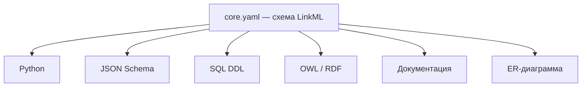
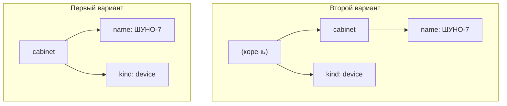
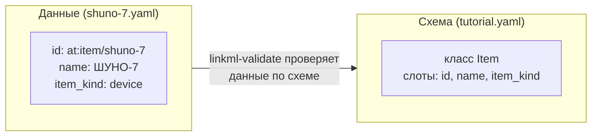
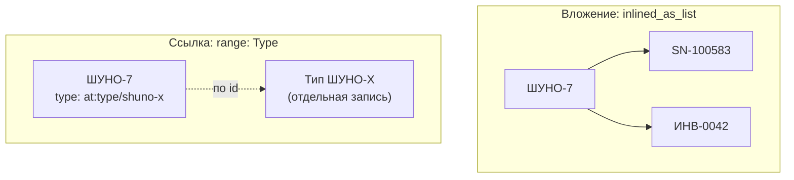
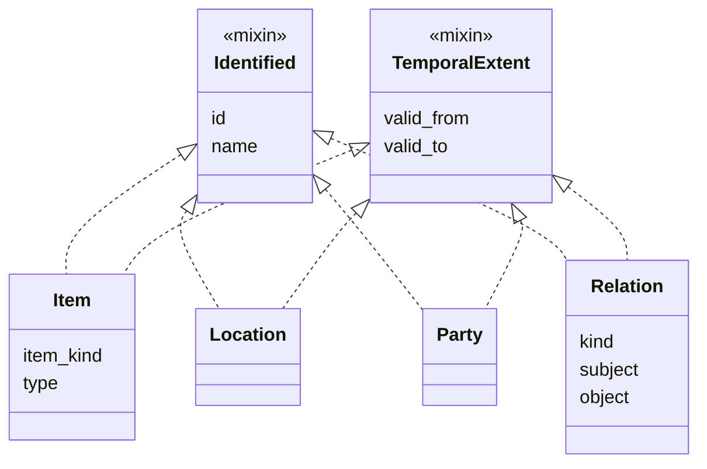
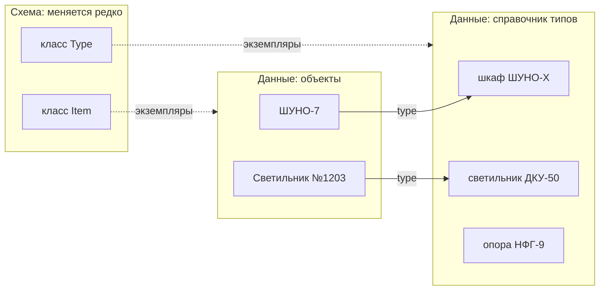
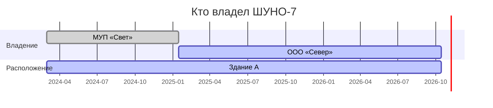
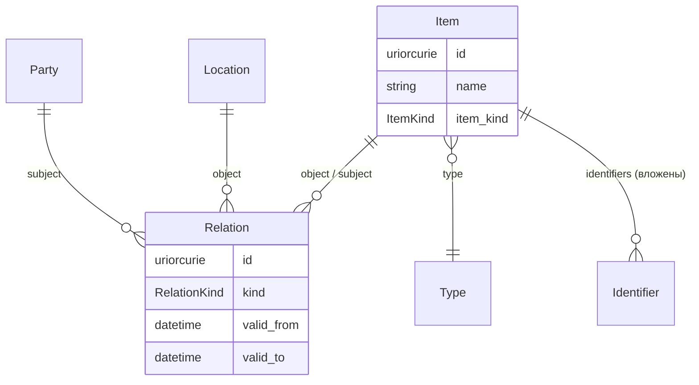
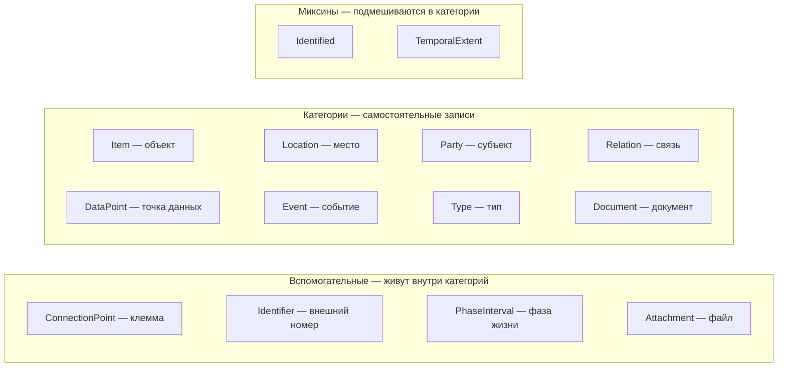

# Введение в LinkML: как описать онтологию, если вы раньше проектировали базы данных

> Статус: **учебный материал**, не нормативная схема. Изменено: 2026-10-14.
> Норма — [`core-categories.md`](core-categories.md) и [`schema/core.yaml`](schema/core.yaml).
> Для кого: вы пишете код и проектировали таблицы в SQL, но YAML и LinkML видите впервые.
> Все примеры проверены на LinkML 1.12.

## Что вы получите после чтения

Через полчаса вы сможете открыть [`schema/core.yaml`](schema/core.yaml) и понять каждую строку: какие там «таблицы», какие «колонки», почему одни вещи вынесены в отдельные записи, а другие нет. И сможете сами добавить в схему поле или класс так, чтобы генератор её принял.

Текст построен как одна сквозная задача: мы с нуля опишем учебный кусочек нашей модели — шкаф уличного освещения, здание, в котором он стоит, и организацию, которая им владеет. По ходу дела введём всё, что нужно знать о LinkML. В конце соберём схему целиком и проверим на ней данные.

---

## 1. Зачем это всё

### 1.1. Что такое онтология простыми словами

Онтология — это договорённость о том, **какие вещи существуют в нашем мире и как они связаны**. Например: «есть объекты (шкафы, светильники, кабели), есть места (город, улица, здание), есть субъекты (организации, люди). Объект расположен в месте. Субъект владеет объектом. У каждого факта есть время начала и конца».

Если вы проектировали базу данных, вы уже делали почти то же самое: рисовали ER-диаграмму, решали, какие будут таблицы и внешние ключи. Разница в том, что онтология:

- **не привязана к конкретной СУБД** — это модель, а не DDL;
- **общая для многих систем** — по ней пишут код, проверяют данные, обмениваются с внешними системами;
- **несёт смысл, а не только структуру** — у каждого поля есть описание, у каждого кода — человеческая подпись, и всё это можно выгрузить в документацию или в форматы семантического веба (OWL, RDF).

### 1.2. Почему не просто SQL

Можно было бы записать модель как `CREATE TABLE ...`. Но тогда:

- Python-разработчику придётся вручную писать классы под эти таблицы;
- фронтенду — JSON Schema для форм;
- для обмена с внешними системами — ещё одно описание;
- документацию — отдельно руками.

Четыре описания одной модели быстро разъезжаются. LinkML решает это так: **модель пишется один раз**, а всё остальное из неё генерируется.



**Рисунок 1.** Один источник истины — много представлений. Правится только `core.yaml`.

### 1.3. Что такое LinkML

**LinkML** (Linked Data Modeling Language) — язык описания моделей данных. Сама схема — это обычный текстовый файл в формате YAML. Плюс набор утилит на Python: генераторы (`gen-pydantic`, `gen-json-schema`, …) и валидатор (`linkml-validate`), который проверяет, что данные соответствуют схеме.

Важная мысль, которая снимет половину вопросов: **LinkML — это не база данных и не язык запросов**. Он ничего не хранит. Это способ записать «какие бывают таблицы и колонки» так, чтобы машина могла по этому описанию сделать всё остальное.

---

## 2. YAML за десять минут

Схема LinkML пишется в YAML, поэтому сначала разберёмся с ним. Если вы знаете JSON — вы знаете YAML на 80%.

### 2.1. YAML — это JSON без скобок

Вот один и тот же объект в двух форматах:

```json
{
  "name": "ШУНО-7",
  "kind": "device",
  "tags": ["улица", "шкаф"],
  "location": { "city": "Тверь", "street": "Ленина" }
}
```

```yaml
name: ШУНО-7
kind: device
tags:
  - улица
  - шкаф
location:
  city: Тверь
  street: Ленина
```

Что изменилось:

- фигурных скобок нет — вложенность показывается **отступом**;
- квадратных скобок нет — элемент списка начинается с **дефиса и пробела** `- `;
- кавычки у строк обычно не нужны.

Всё. Других принципиальных отличий для наших целей нет.

### 2.2. Отступ — это синтаксис

Как в Python, отступ в YAML несёт смысл. Сдвинули строку — поменяли структуру данных.

```yaml
cabinet:
  name: ШУНО-7
  kind: device      # kind — поле шкафа
```

```yaml
cabinet:
  name: ШУНО-7
kind: device        # kind — отдельный ключ верхнего уровня, к шкафу отношения не имеет
```



**Рисунок 2.** Два почти одинаковых текста — два разных дерева.

Правила отступов:

- только **пробелы**, никаких табов (таб — ошибка разбора);
- в нашем репозитории — **два пробела** на уровень;
- все ключи одного уровня должны стоять ровно друг под другом.

### 2.3. Ловушки

| Что написали | Что получилось | Как правильно |
|---|---|---|
| `name: ШУНО: 7` | ошибка: двоеточие с пробелом читается как ещё один ключ | `name: "ШУНО: 7"` |
| `code: #42` | значение пустое: всё после `#` — комментарий | `code: "#42"` |
| `answer: no` | в старых парсерах — булево `false`, а не строка | `answer: "no"` |
| `version: 1.10` | число 1.1 | `version: "1.10"` |
| таб в начале строки | ошибка разбора | пробелы |

Простое правило: **если сомневаетесь — берите значение в кавычки**. Идентификаторы и даты в наших примерах всегда в кавычках.

### 2.4. Ещё две вещи, которые встретятся в `core.yaml`

**Комментарий** начинается с `#` и идёт до конца строки. Он виден только в исходнике и никуда не попадает. Если текст должен попасть в документацию — используют поле `description`.

**Длинный текст** записывают так:

```yaml
description: >-
  Физическая или логическая вещь, которой владеют,
  которую обслуживают и могут заменить.
```

Символ `>-` означает «склей следующие строки в один абзац». Это просто способ не писать километровую строку.

**Короткая запись списка** в квадратных скобках тоже допустима — это кусочек JSON внутри YAML:

```yaml
mixins: [Identified, TemporalExtent]
# то же самое, что:
mixins:
  - Identified
  - TemporalExtent
```

---

## 3. Словарь: из чего состоит схема LinkML

Перед тем как писать, договоримся о словах. Почти всё в LinkML имеет прямой аналог в реляционных базах.

| В базе данных | В LinkML | Ключ в YAML |
|---|---|---|
| таблица | **класс** (class) | `classes:` |
| колонка | **слот** (slot) | `slots:` |
| тип колонки | **диапазон** (range) | `range:` |
| первичный ключ | идентификатор | `identifier: true` |
| `NOT NULL` | обязательность | `required: true` |
| внешний ключ | слот, у которого `range` — другой класс | `range: Location` |
| `CHECK (x IN ('a','b'))` | **перечисление** (enum) | `enums:` |
| строка таблицы | **экземпляр** (instance) | пишется в отдельном файле данных |

Непривычное здесь одно слово — **слот**. Это просто колонка, но с одной особенностью: слот описывается **один раз на всю схему**, а потом подключается к любому количеству классов. Колонка `name` в SQL есть в каждой таблице отдельно; слот `name` в LinkML — один, и десять классов на него ссылаются.

Схема и данные — **разные файлы**:



**Рисунок 3.** Схема — это `CREATE TABLE`. Данные — это `INSERT`. Валидатор проверяет, что `INSERT` подходит под `CREATE TABLE`.

---

## 4. Первая схема: один класс

Начнём с минимума: опишем шкаф с идентификатором и названием.

### 4.1. Шапка файла

Любая схема начинается с паспорта:

```yaml
id: https://autothing.dev/ontology/tutorial
name: autothing-tutorial
title: Учебная схема
prefixes:
  linkml: https://w3id.org/linkml/
  at: https://autothing.dev/ontology/tutorial/
default_prefix: at
default_range: string
imports:
  - linkml:types
```

Построчно:

- `id` — уникальный адрес **самой схемы**, как имя пакета в Java (`com.company.project`). Это не идентификатор шкафа и вообще не данные. По этому адресу ничего не обязано открываться.
- `name` — короткое машинное имя схемы, без пробелов.
- `title` — человеческое название.
- `prefixes` — сокращения для длинных адресов. Запись `at: https://autothing.dev/ontology/tutorial/` значит, что в данных можно писать `at:item/shuno-7` вместо `https://autothing.dev/ontology/tutorial/item/shuno-7`. Это как `import numpy as np`.
- `default_prefix` — к какому префиксу относятся имена, объявленные в этой схеме.
- `default_range: string` — если у слота не указан тип, он считается строкой.
- `imports: linkml:types` — подключить встроенные типы: `string`, `integer`, `boolean`, `float`, `date`, `datetime`, `uri`, `uriorcurie`. Без этой строки генераторы не знают, что такое `datetime` или `uriorcurie`. **Пишите её всегда.**

Эту шапку можно копировать из файла в файл, меняя только `id`, `name` и `title`.

### 4.2. Класс и его слоты

Теперь — сама «таблица»:

```yaml
classes:
  Item:
    title: Объект
    description: Физическая или логическая вещь — шкаф, светильник, кабель.
    slots:
      - id
      - name

slots:
  id:
    identifier: true
    range: uriorcurie
  name:
    title: Название
    required: true
```

Тут два блока, и это главное, что нужно понять про LinkML:

1. В блоке `classes` класс `Item` **перечисляет имена** слотов, которые у него есть: `id` и `name`.
2. В блоке `slots` каждый слот **описан**: какой у него тип, обязателен ли он.

Аналогия с SQL — как если бы вы сначала объявили домены (`CREATE DOMAIN`) для всех колонок проекта, а в таблицах только ссылались на них.

Самая частая ошибка новичка: описать слот в блоке `slots` и забыть вписать его имя в класс. Тогда у класса **такой колонки не будет**, и генератор не скажет об этом ни слова. Описание слота само по себе ни к какому классу не относится.

Про имена: в нашем репозитории классы называются `ВотТак` (PascalCase, по-английски), слоты — `вот_так` (snake_case, по-английски), а русские названия пишутся в `title`. Подробно — в [`notation.md`](notation.md).

### 4.3. Первые данные

Экземпляр шкафа — отдельный файл `shuno-7.yaml`:

```yaml
id: "at:item/shuno-7"
name: ШУНО-7
```

Проверка:

```text
linkml-validate -s tutorial.yaml -C Item shuno-7.yaml
```

Здесь `-s` — файл схемы, `-C` — какой класс мы проверяем. Если всё хорошо, валидатор ответит `No issues found`.

---

## 5. Типы, обязательность, списки

### 5.1. Типы значений

Тип колонки задаётся ключом `range`. Варианты:

- **встроенный тип**: `string`, `integer`, `float`, `boolean`, `date`, `datetime`, `uri`, `uriorcurie`;
- **перечисление** — закрытый список кодов (раздел 7);
- **другой класс** — тогда это ссылка, внешний ключ (раздел 6).

`uriorcurie` — тип для идентификаторов: принимает и полный адрес `https://...`, и сокращённый `at:item/shuno-7`. Все `id` в нашей схеме имеют этот тип.

Если нужны ограничения как в `CHECK`, у слота есть `pattern` (регулярное выражение), `minimum_value`, `maximum_value`. Пока они нам не понадобятся.

### 5.2. Сколько значений может быть в поле

Это решается тремя флагами на слоте:

| Флаги | Сколько значений | Аналог в SQL |
|---|---|---|
| ничего | 0 или 1 | обычная колонка, `NULL` разрешён |
| `required: true` | ровно 1 | `NOT NULL` |
| `multivalued: true` | 0 и больше | дочерняя таблица или массив |
| `required` + `multivalued` | 1 и больше | непустой массив |
| `identifier: true` | ровно 1, уникальный | `PRIMARY KEY` |

Добавим шкафу интервал существования и вид:

```yaml
slots:
  valid_from:
    range: datetime
    required: true
  valid_to:
    range: datetime
```

`valid_from` обязателен: у любого объекта есть момент, с которого он существует в модели. `valid_to` — нет: пока объект жив, конец интервала пуст. Это та же идея, что «открытая запись» в бухгалтерии.

### 5.3. Как выглядит ошибка

Возьмём неправильные данные — забыли дату и написали несуществующий вид:

```yaml
id: "at:item/shuno-8"
name: ШУНО-8
item_kind: lamp
```

Валидатор ответит:

```text
[ERROR] [bad.yaml/0] 'lamp' is not one of ['device', 'connection', 'structure'] in /item_kind
[ERROR] [bad.yaml/0] 'valid_from' is a required property in /
```

Ошибки понятные: указано поле и причина. Именно ради этого всё и затевается — плохие данные не проходят в систему.

### 5.4. Обязательно везде или только здесь

Иногда слот общий, но обязательным он должен быть только в одном классе. Например, слот `subject` («от кого связь») в одних классах может отсутствовать, а у связи без него нельзя. Для этого есть `slot_usage` — уточнение слота **внутри одного класса**:

```yaml
classes:
  Relation:
    slots:
      - subject
    slot_usage:
      subject:
        required: true
```

Правило выбора простое:

- требование верно **для всех** классов, где есть слот → пишем в блоке `slots`;
- требование верно **для одного** класса → пишем в `slot_usage` этого класса.

---

## 6. Ссылки между классами

### 6.1. Ссылка = внешний ключ

Если в `range` стоит имя класса, значение поля — **идентификатор** экземпляра этого класса:

```yaml
classes:
  Item:
    slots:
      - type

slots:
  type:
    range: Type
```

В данных:

```yaml
id: "at:item/shuno-7"
name: ШУНО-7
type: "at:type/shuno-x"     # просто id, как значение внешнего ключа
```

Сам тип `at:type/shuno-x` описан где-то в другом месте, своей записью. Шкаф на него только ссылается.

### 6.2. Вложение = часть, у которой нет своей жизни

Бывают данные, которые не имеют смысла отдельно от владельца. Например, внешние идентификаторы шкафа: серийный номер, инвентарный номер, номер в старой системе. Им не нужен собственный глобальный id, на них никто не ссылается. Их удобнее хранить **прямо внутри** шкафа:

```yaml
slots:
  identifiers:
    range: Identifier
    multivalued: true
    inlined_as_list: true
```

`inlined_as_list: true` значит «в данных здесь лежат сами объекты списком, а не их id»:

```yaml
id: "at:item/shuno-7"
name: ШУНО-7
identifiers:
  - value: "SN-100583"
    system: vendor-serial
  - value: "ИНВ-0042"
    system: inventory
```



**Рисунок 4.** Слева — две независимые записи и ссылка между ними. Справа — одна запись, внутри которой лежат её части.

Как выбрать:

| Вопрос | Да → | Нет → |
|---|---|---|
| На эту вещь будут ссылаться из других мест? | ссылка | вложение |
| У вещи есть свой жизненный цикл, её можно найти отдельно? | ссылка | вложение |
| Это просто «подробности» владельца? | вложение | ссылка |

В ядре autothing `Identifier` (внешний номер), `PhaseInterval` (фаза жизни) и `Attachment` (файл) — вложения. Всё остальное — самостоятельные записи со ссылками.

---

## 7. Перечисления

Когда у поля короткий закрытый список значений, его оформляют как `enum`:

```yaml
enums:
  ItemKind:
    title: Вид объекта
    permissible_values:
      device:
        title: устройство
      connection:
        title: соединение
        description: Кабель, линия, труба — носитель связи.
      structure:
        title: несущая конструкция

slots:
  item_kind:
    range: ItemKind
    required: true
```

В данных пишут **код**, а не русское название:

```yaml
item_kind: device
```

Русская подпись (`title`) уходит в документацию и интерфейс. Код в данных стабилен и не зависит от языка.

**Когда enum, а когда нет.** Добавить значение в enum — значит поменять схему, пройти ревью, выпустить новую версию. Поэтому enum годится только для списков, которые меняются редко: вид объекта, фаза жизненного цикла, статус документа.

Для длинных растущих справочников — модели светильников, производители, марки кабеля — enum не подходит. Каждый новый светильник в каталоге означал бы правку схемы. Такие вещи хранят как **данные** — записи класса `Type`. Об этом подробнее в разделе 9.

---

## 8. Миксины и наследование: не повторять одно и то же

### 8.1. Проблема

У шкафа, места, организации и связи есть одинаковые поля: `id`, `name`, `valid_from`, `valid_to`. Писать их в каждом классе — дублирование, и рано или поздно кто-то забудет одно поле в одном классе.

### 8.2. Миксин — набор полей, который подмешивают

**Миксин** (mixin) — класс, который сам по себе не используется, а служит набором полей для других классов. Помечается флагом `mixin: true`:

```yaml
classes:
  Identified:
    title: Идентифицируемость
    mixin: true
    slots:
      - id
      - name

  TemporalExtent:
    title: Протяжённость во времени
    mixin: true
    slots:
      - valid_from
      - valid_to

  Item:
    title: Объект
    mixins: [Identified, TemporalExtent]
    slots:
      - item_kind
```

Теперь у `Item` есть `id`, `name`, `valid_from`, `valid_to` (пришли от миксинов) и `item_kind` (свой). Повторять полученные поля в списке `slots` не нужно.



**Рисунок 5.** Два миксина подмешаны в четыре класса. Поля описаны один раз.

Есть и бонус: миксин можно использовать как тип ссылки. Слот с `range: Identified` принимает id **любого** класса, куда подмешан `Identified` — объекта, места, субъекта. Это нам понадобится для связей.

### 8.3. `is_a` — обычное наследование

Есть и привычное наследование: `is_a: Родитель`. Потомок получает все поля родителя и считается его разновидностью. Отличия от миксина:

| | `mixins` | `is_a` |
|---|---|---|
| Сколько | несколько | ровно один родитель |
| Смысл | «умеет / имеет набор полей» | «является разновидностью» |
| Аналог | интерфейс с полями, trait | `extends` |

### 8.4. Главное предостережение

Программисту хочется построить дерево классов: `Item → Device → Luminaire → LedLuminaire → LedLuminaireModelX`. **В autothing так не делают.** Класс `Item` один на всё: шкаф, светильник, кабель, опора. Чем именно является объект — говорят два поля:

- `item_kind` — грубый вид из короткого enum (устройство, соединение, конструкция…);
- `type` — ссылка на запись справочника типов («светильник модели X производителя Y»).

Новый подкласс заводят, только если у вещи **другой набор полей**, а не другое название. Пример из ядра: клемма (`ConnectionPoint`) — не подкласс `Item`, потому что у неё нет своего глобального id, её идентичность — «родитель + обозначение» (`ШУНО-7`, `X1:3`).

---

## 9. Два приёма, на которых держится наша модель

Всё предыдущее — общий LinkML. Этот раздел — о том, как мы им пользуемся и почему схема `core.yaml` выглядит именно так.

### 9.1. Тип — это данные, а не класс



**Рисунок 6.** Новая модель светильника — новая строка в данных. Схема и таблицы базы при этом не меняются.

Для разработчика это знакомо: вместо таблицы на каждый вид товара — одна таблица товаров и справочник категорий. Миграция базы при появлении нового прибора не нужна (см. [`storage.md`](../implementation/storage.md)).

### 9.2. Связь — это отдельная запись с интервалом

Самое неочевидное место для человека из мира SQL.

Обычный подход: у шкафа колонка `owner_id`. Но владелец меняется. Шкаф передали от МУП «Свет» компании «Север» 15 января 2025. С колонкой `owner_id` старый владелец просто затирается, и на вопрос «кто отвечал за шкаф в июне 2024?» ответа уже нет.

Поэтому в autothing **факт «X владеет Y» — это отдельная запись класса `Relation`** со своим интервалом:

```yaml
classes:
  Relation:
    title: Связь
    mixins: [Identified, TemporalExtent]
    slots:
      - kind
      - subject
      - object
    slot_usage:
      kind:
        required: true
      subject:
        required: true
      object:
        required: true

slots:
  kind:
    range: RelationKind     # owns, located_in, ...
  subject:
    range: Identified       # «от кого» — любой класс с миксином Identified
  object:
    range: Identified       # «к кому»
```

Внимание на названия: `subject` и `object` здесь — **роли концов связи** («от кого» и «к кому»), а не классы. Класс организации называется `Party`, класс вещи — `Item`.

Смена владельца — это две записи:

```yaml
- id: "at:rel/shuno-7-owns-1"
  name: МУП Свет владеет ШУНО-7
  kind: owns
  subject: "at:party/mup-svet"
  object: "at:item/shuno-7"
  valid_from: "2024-03-01T00:00:00Z"
  valid_to: "2025-01-15T00:00:00Z"      # закрыта

- id: "at:rel/shuno-7-owns-2"
  name: Север владеет ШУНО-7
  kind: owns
  subject: "at:party/sever"
  object: "at:item/shuno-7"
  valid_from: "2025-01-15T00:00:00Z"    # valid_to пуст — действует сейчас
```



**Рисунок 7.** Каждая полоса — одна запись `Relation`. История не теряется: старая запись не удаляется, а закрывается датой.

Вопрос «кто владел шкафом 1 июня 2024» превращается в простой фильтр: `kind = owns`, `object = шкаф`, `valid_from ≤ дата`, и `valid_to` пуст или больше даты.

Что LinkML **не** проверяет: что у шкафа в один момент не два владельца. Схема описывает форму одной записи, а такие правила между записями — работа базы данных (см. ограничения в [`storage.md`](../implementation/storage.md)).

Общая картина учебной модели:



**Рисунок 8.** Объекты, места и субъекты не ссылаются друг на друга напрямую — все связи между ними идут через записи `Relation`.

---

## 10. Собираем и проверяем

### 10.1. Схема целиком

Всё, что мы написали, в одном файле. Он проверен генератором и валидатором.

```yaml
id: https://autothing.dev/ontology/tutorial
name: autothing-tutorial
title: Учебная схема
prefixes:
  linkml: https://w3id.org/linkml/
  at: https://autothing.dev/ontology/tutorial/
default_prefix: at
default_range: string
imports:
  - linkml:types

classes:

  Identified:
    title: Идентифицируемость
    mixin: true
    slots: [id, name]

  TemporalExtent:
    title: Протяжённость во времени
    mixin: true
    slots: [valid_from, valid_to]

  Item:
    title: Объект
    mixins: [Identified, TemporalExtent]
    slots: [item_kind, type, identifiers]

  Location:
    title: Место
    mixins: [Identified, TemporalExtent]

  Party:
    title: Субъект
    mixins: [Identified, TemporalExtent]

  Type:
    title: Тип
    mixins: [Identified]
    slots: [manufacturer]

  Identifier:
    title: Внешний идентификатор
    slots: [value, system]
    slot_usage:
      value:
        required: true

  Relation:
    title: Связь
    mixins: [Identified, TemporalExtent]
    slots: [kind, subject, object]
    slot_usage:
      kind:
        required: true
      subject:
        required: true
      object:
        required: true

  Registry:
    title: Реестр
    description: Корень файла данных — чтобы класть много записей в один файл.
    tree_root: true
    slots: [items, relations]

slots:
  id:
    identifier: true
    range: uriorcurie
  name:
    title: Название
    required: true
  valid_from:
    range: datetime
    required: true
  valid_to:
    range: datetime
  item_kind:
    range: ItemKind
    required: true
  type:
    range: Type
  manufacturer:
    title: Производитель
  identifiers:
    range: Identifier
    multivalued: true
    inlined_as_list: true
  value:
  system:
  kind:
    range: RelationKind
  subject:
    range: Identified
  object:
    range: Identified
  items:
    range: Item
    multivalued: true
    inlined_as_list: true
  relations:
    range: Relation
    multivalued: true
    inlined_as_list: true

enums:
  ItemKind:
    title: Вид объекта
    permissible_values:
      device:
        title: устройство
      connection:
        title: соединение
      structure:
        title: несущая конструкция
  RelationKind:
    title: Вид связи
    permissible_values:
      located_in:
        title: расположен в
      owns:
        title: владеет
```

Пустые `value:` и `system:` в блоке `slots` — не опечатка: слот без настроек получает тип по умолчанию (`string`).

Класс `Registry` с `tree_root: true` — служебный. Он нужен, чтобы в одном файле данных можно было держать много записей: `items` и `relations` — списки вложенных объектов. Валидатор, найдя `tree_root`, сам поймёт, с какого класса начинать, и ключ `-C` можно не указывать.

### 10.2. Установка и команды

```text
pip install linkml
```

| Команда | Что делает |
|---|---|
| `gen-linkml schema.yaml` | проверяет, что схема собирается (используем как «компиляцию») |
| `linkml-validate -s schema.yaml data.yaml` | проверяет данные по схеме |
| `linkml-validate -s schema.yaml -C Item item.yaml` | то же для одной записи класса `Item` |
| `linkml-lint schema.yaml` | советы по стилю: нет описаний, странные имена |
| `gen-pydantic schema.yaml` | классы Python |
| `gen-json-schema schema.yaml` | JSON Schema |
| `gen-sqltables schema.yaml` | черновик SQL DDL |
| `gen-erdiagram schema.yaml` | ER-диаграмма в Mermaid |
| `gen-doc schema.yaml -d docs/` | документация в Markdown |

`gen-linkml` ловит не всё: например, не заметит отсутствие встроенных типов. Для надёжности после правки схемы прогоняйте ещё `gen-pydantic` — он строже.

На Windows перед `linkml-lint` выполните `$env:PYTHONUTF8=1` — иначе он падает на русских символах в консоли.

### 10.3. Частые ошибки

| Симптом | Причина |
|---|---|
| поля нет в сгенерированном классе | слот описан в `slots`, но не вписан в класс и не пришёл с миксином |
| `gen-pydantic` падает с `Exception: range: uriorcurie` (а `gen-linkml` при этом молчит) | забыли `imports: - linkml:types` |
| ошибка разбора YAML | таб вместо пробелов, или двоеточие с пробелом внутри значения без кавычек |
| валидатор требует поле, которого «не должно быть» | `required: true` стоит на общем слоте, а нужно было в `slot_usage` одного класса |
| вместо id в данных ожидается объект (или наоборот) | перепутали ссылку и `inlined_as_list` |
| в enum пришлось добавить 200-е значение | это справочник, ему место в данных (`Type`), а не в enum |

---

## 11. Как читать настоящий `core.yaml`

Теперь вы знаете всё, что нужно. Ядро устроено точно так же, только классов больше:



**Рисунок 9.** Карта `core.yaml`.

Порядок чтения файла:

1. **Шапка** — как в разделе 4.1.
2. **Миксины** `Identified`, `TemporalExtent` — у `TemporalExtent` в ядре есть ещё `started_by` и `ended_by`: ссылки на события, открывшие и закрывшие интервал.
3. **Категории** — восемь классов. Смысл каждой — в [`core-categories.md`](core-categories.md).
4. **Вспомогательные классы** — то, что вкладывается внутрь категорий.
5. **Слоты** — описания всех полей. Читайте `description`: там записано, зачем поле и каким решением оно введено.
6. **Перечисления** — виды объектов, семейства связей, фазы, статусы.

У `Relation` в ядре больше полей, чем в учебном примере: `family` (семейство связи — структурная, потоковая, ответственность…), `subject_port` / `object_port` (к каким клеммам подключено), `carrier` (по какому кабелю идёт), `basis` (договор или акт, на основании которого связь возникла). Механика та же, что в разделе 9.2.

### Как добавить своё

**Новое поле.** Опишите слот в блоке `slots` (имя `snake_case`, русский `title`, `range`), впишите имя в нужный класс, решите, где ставить `required` — на слоте или в `slot_usage`. Запустите `gen-linkml schema/core.yaml`.

**Новый класс** — только после того, как не получилось обойтись существующими. Если он нужен одной вертикали (только уличному освещению, только BMS) — ему место в отдельном файле `schema/ext-*.yaml`, который импортирует ядро. В ядро — только если без него нельзя ответить на вопрос из [`questions.md`](questions.md). Правила — в [рабочей области](README.md).

**Нерешённый вопрос** в схему не кладут. На его месте оставляют комментарий `# TODO:` со ссылкой на пункт в `core-categories.md`.

### Шпаргалка

| Хочу | Пишу |
|---|---|
| таблицу | класс в `classes` |
| колонку | слот в `slots` + имя слота в списке класса |
| первичный ключ | `identifier: true`, `range: uriorcurie` |
| `NOT NULL` для всех | `required: true` на слоте |
| `NOT NULL` в одном классе | `slot_usage` этого класса |
| список значений | `multivalued: true` |
| внешний ключ | `range: ИмяКласса` |
| вложенные части без своего id | `range: ИмяКласса` + `multivalued` + `inlined_as_list` |
| закрытый короткий список | `enums` |
| модель прибора, производитель | запись класса `Type` в данных |
| общие поля для многих классов | миксин |
| факт со временем между двумя вещами | запись `Relation` |
| подпись по-русски | `title` |
| текст в документацию | `description` (не `#`) |

Что читать дальше: [категории ядра](core-categories.md) → [`schema/core.yaml`](schema/core.yaml) → [нотация](notation.md) → [хранение в PostgreSQL](../implementation/storage.md).
